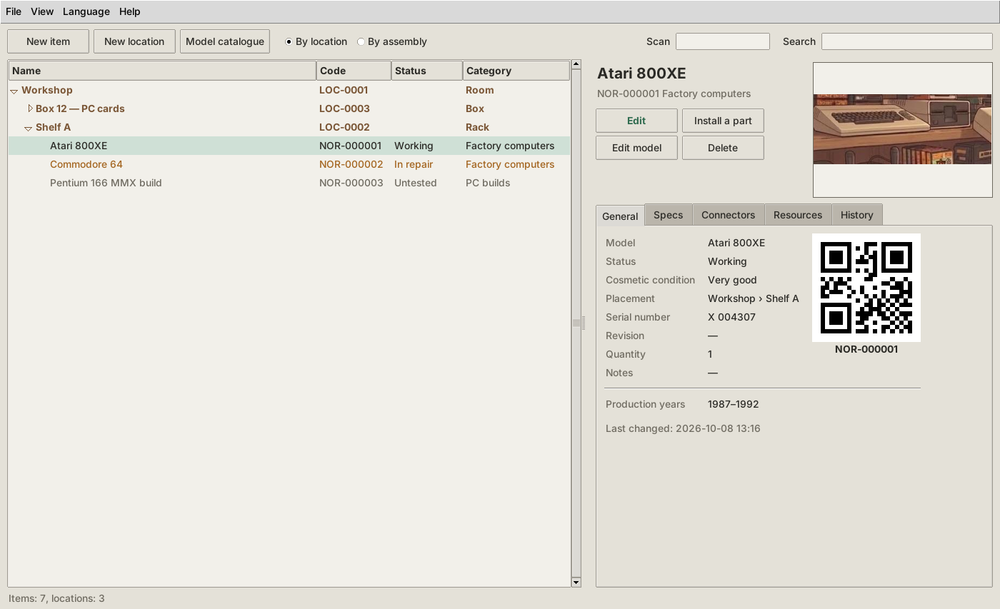
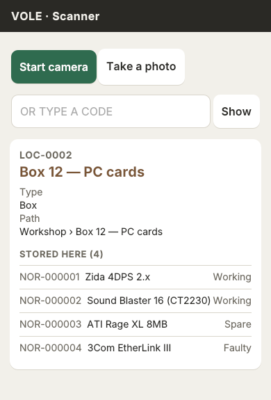
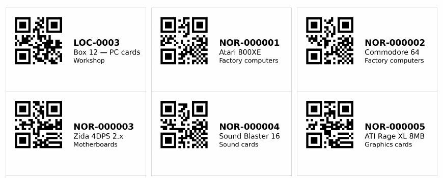
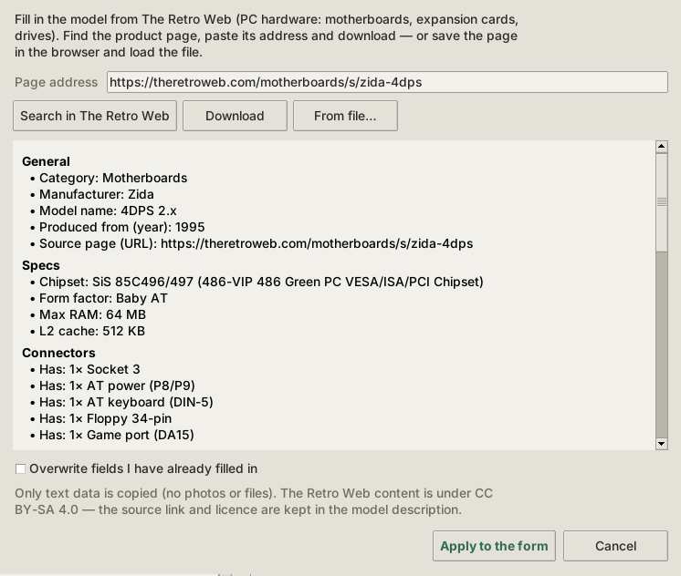

  

Illustration generated with AI (Google Gemini) — see <a href="zasoby/GRAFIKA.md">zasoby/GRAFIKA.md</a>.

# VOLE / NORNICA

### ⬇️ [Download the latest version for Windows](https://github.com/DarkZachi83/Nornica/releases/latest) – no Python installation needed.
*⬇️ [Pobierz najnowszą wersję dla Windows](https://github.com/DarkZachi83/Nornica/releases/latest) – bez instalowania Pythona.*

**A desktop catalogue for a home collection of retro computers** — factory-built
machines, PC builds, spare parts and accessories. Where every item is, what is
inside it, what works and what is waiting for repair.

The interface is available in English (**VOLE**) and Polish (**NORNICA**,
"vole" in Polish) and can be switched while the program is running.

[Polska wersja README](README.pl.md)

> ⭐ **Like the program? Please leave a star** — it helps the project keep
> growing, and it means a lot to the author 🙂

## Features

- **Items and locations as a tree** — rooms, racks, shelves, boxes; view the
  collection by location or by assembly.
- **Assemblies** — a PC build is an item made of other items (motherboard,
  cards, drives); install and remove parts, keep a test and repair history.
- **Model catalogue** — manufacturer, production years, specs per category
  (chipset, RAM, capacity…) and connectors (what a device has and what it needs).
- **Your own categories, fields and statuses** — add text, number, yes/no, list
  or capacity fields to any category; subcategories inherit them. Built-in
  entries are read-only and deletion is guarded ("still used by…").
- **QR labels** — every item and location gets a code (`NOR-000001`,
  `LOC-0001`); print A4 label sheets (Avery) or labels for Brother / Dymo printers, as PDF or PNG.
- **Phone as a scanner** — the program starts a local HTTPS server and shows a
  QR code; the phone opens a web page (no app to install), scans labels with the
  live camera and can add photos to an item. Works on Android and iPhone.
  Since version 0.6.1 the phone certificate authority is limited to home
  networks (it cannot vouch for any other site, even if its key leaked).
  An authority created by an older version keeps working; to switch to the
  limited one, delete the `certyfikat` folder in the data folder and install
  `ca.crt` on the phone again.
- **Stocktake with the phone** — scan a rack's label, tap "Start stocktake here"
  and scan everything that is really there; the program compares it with the
  database (sub-locations included) and reports what is in place, what was found
  here but is recorded elsewhere, and what is missing (File → Stocktakes…).
- **USB / Bluetooth barcode readers** — the *Scan* field in the toolbar (F2).
- **The Retro Web import** — fill in a PC hardware model (motherboards,
  expansion cards, drives) from [The Retro Web](https://theretroweb.com):
  preview first, then apply to the form. Text data only, CC BY-SA 4.0 with
  attribution kept.
- **Photos, documents and links** for items and models.
- **Collection clean-up** — find unattached files, files without a record, empty
  locations, unused models and manufacturers, items without a place and
  repeated serial numbers; nothing is deleted without your confirmation.
- **Export** — `.xlsx`, `.xls`, `.csv`, `.html`.
- **Backup to a single ZIP** (File → Backup…, Ctrl+B) — the database and all
  attached files, verified after writing; restore checks the whole backup first
  and keeps the current database aside before replacing it.
- **AI assistant** (model window → *AI assistant…*) — type the chip or label
  markings, the assistant searches the web and a local model (Ollama) picks the
  spec values. Every suggestion has a source and a verbatim quote; the program
  itself checks that the quote is on the page and that the value fits the
  field. You tick what you accept — data goes into the form, not the database.
- **Light and dark theme** — the ☀/☾ button in the toolbar or View menu;
  the choice is remembered. Sharp text on Windows with 125–150% scaling.
- **Safe data** — SQLite with atomic, checksummed schema migrations and an
  automatic backup before every upgrade.

| Phone scanner | Label sheet | The Retro Web |
|---|---|---|
|  |  |  |

## Download for Windows

A ready-to-run package — no Python needed: download
`NORNICA-…-windows-x64.zip` from
[**Releases**](https://github.com/DarkZachi83/Nornica/releases/latest),
unzip it anywhere and run `NORNICA.exe`. The program is not signed with a paid
certificate, so Windows SmartScreen may warn on the first start: click
**More info → Run anyway**. Each package is built and checked automatically on
Windows by GitHub Actions.

The sections below are for running from source (Linux, or Windows with Python).

## Requirements

Python 3.10+ with tkinter, SQLite 3.35+ with JSON support (standard in current
Python builds).

**Arch Linux**

    sudo pacman -S python tk python-pillow python-qrcode python-reportlab python-openpyxl python-cryptography

Libraries not packaged by Arch (ttkbootstrap — modern look and dark theme,
xlwt — legacy .xls export) go into a separate environment: Arch does not allow
`pip install` into the system Python (PEP 668). The environment still sees
the pacman packages:

    python -m venv --system-site-packages ~/.venvs/nornica
    ~/.venvs/nornica/bin/pip install ttkbootstrap==2.2.7 xlwt
    ~/.venvs/nornica/bin/python nornica.py

**Debian / Ubuntu**

    sudo apt install python3 python3-tk
    pip install -r requirements.txt

**Windows 10/11** — Python from python.org with "tcl/tk and IDLE" ticked, then

    pip install -r requirements.txt

Every library is optional: without it the program still starts and only the
related feature is disabled (with a message saying why).

## Running

    python nornica.py                  # the program
    python nornica.py --jezyk en       # choose the language (remembered)
    python nornica.py --bez-powitania  # skip the splash screen
    python nornica.py --konsola        # prepare the database and print a summary

## AI assistant (optional)

NORNICA works without it; the *AI assistant…* button then says what is missing.

1. Install [Ollama](https://ollama.com/download) and pull a model, e.g.
   `ollama pull qwen3:8b` (≈5 GB, fits an 8 GB graphics card; lighter:
   `gemma3:4b`). The model runs only on your computer — the program connects
   to 127.0.0.1 only.
2. Choose a search engine in the assistant window:
   - **Ollama web search** — a free ollama.com account and an API key
     (account settings → *Keys*). Only the query, e.g. "KM44C4100 datasheet",
     goes to Ollama. The key is kept in `ollama_klucz.txt` in the data folder
     (owner-only) or in the `OLLAMA_API_KEY` variable — not in the database
     and not in backups.
   - **SearXNG** — your own search engine, e.g. in Docker; add `json` to
     `search: formats` in `settings.yml`.

Small models can make things up, so values without a confirmed quote are
marked unconfirmed and are not ticked. The memory type (FPM or EDO) usually
follows from the chip markings — type them into the *Markings* field.

## Where your data lives

The database, backups, photos and certificates are **never stored in the code
folder**:

- Linux: `~/.local/share/nornica/`
- Windows: `%APPDATA%\Nornica\`

A different place: environment variable `NORNICA_DANE` or `--baza PATH`.
This keeps the repository clean — `.gitignore` additionally blocks database
files, backups and keys in case someone points the data folder here.

## Tests

    pip install -r requirements-dev.txt
    xvfb-run -a -s "-screen 0 1920x1080x24" python -m unittest discover -s testy -t .

About 510 tests: database, migrations, business rules, i18n key parity
(EN/PL), PDF labels (decoded back with zbar), the phone server, The Retro Web
parser (on saved pages) and the GUI. Without a display the GUI tests are
skipped. CI runs them on every push (GitHub Actions).

## Project layout

    nornica.py           entry point
    konfiguracja.py      platform-dependent data paths
    baza/                SQLite: schema migrations, connection, repositories
    uslugi/              business rules: inventory, labels, export, scanner server, The Retro Web
    asystent/            AI assistant: Ollama, search engines, checking suggestions
    gui/                 tkinter windows
    raporty/             reports
    i18n/                translator, en.json, pl.json
    zasoby/              icons, splash screen, phone page (jsQR)
    testy/               tests and test data
    narzedzia/           developer scripts

Layer rules (checked by `testy/test_architektura.py`): windows in `gui/` read
data through `baza/repozytoria` and change it through `uslugi/`, never with
their own SQL; `baza/` and `uslugi/` do not depend on the GUI. Modules stay
under 600 lines and functions under 90 — anything longer gets split.

Identifiers are in Polish (the author's language); all user-facing text goes
through translation keys.

## Support the project

If NORNICA / VOLE is useful to you, please **leave a star** ⭐ at the top of
this page — it helps others find the project and keeps the work going.
Bug reports and ideas are just as welcome:
[Issues](https://github.com/DarkZachi83/Nornica/issues).

## Licence

Copyright © 2026 Rafał Zacharski

This program is free software: you can redistribute it and/or modify it under
the terms of the GNU General Public License as published by the Free Software
Foundation, either version 3 of the License, or (at your option) any later
version. It is distributed WITHOUT ANY WARRANTY. See [`LICENSE`](LICENSE).

Exceptions: the jsQR library (Apache-2.0, `zasoby/www/`) and the illustration
and project name ([`zasoby/GRAFIKA.md`](zasoby/GRAFIKA.md)). Third-party
licences: [`THIRD_PARTY_NOTICES.md`](THIRD_PARTY_NOTICES.md).

Migration files in `baza/schemat/` intentionally have no licence header: their
checksums are stored in users' databases and the migration guard refuses to
run after an applied file changes. They are covered by the statement above.
